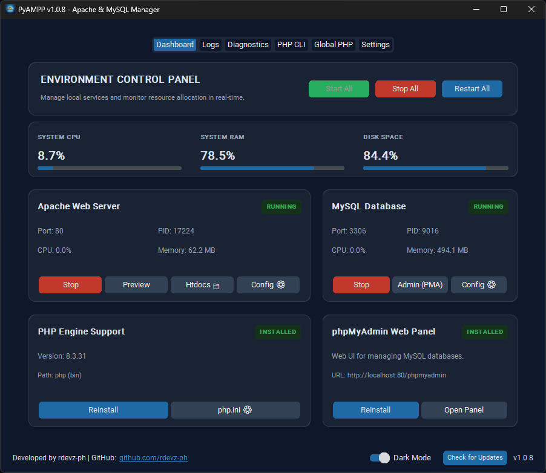
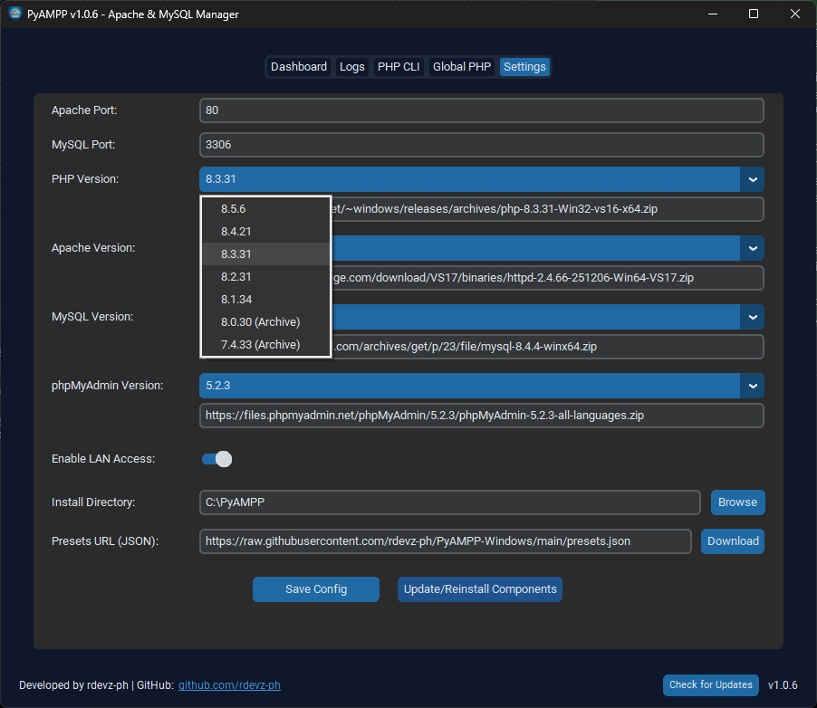
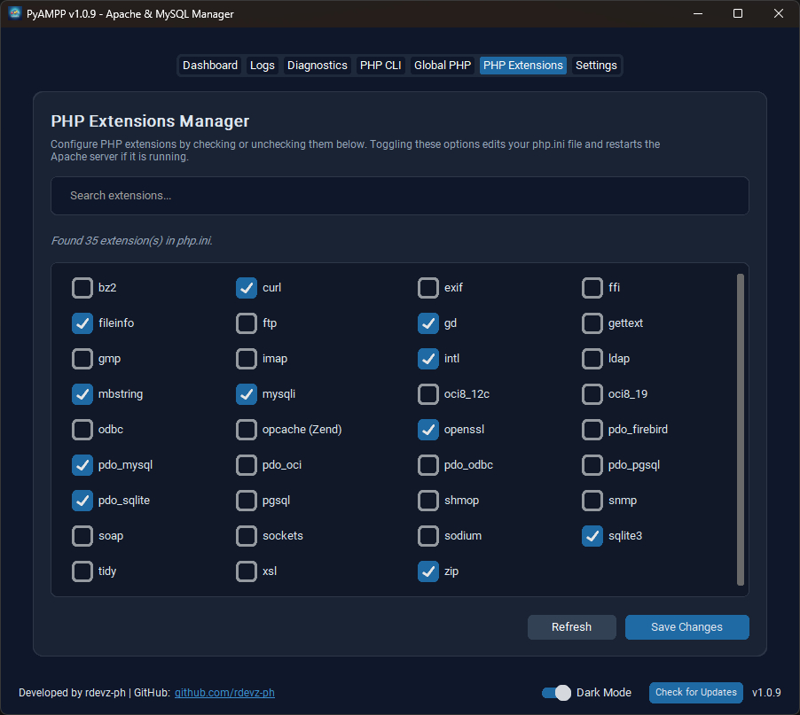

<div align="center">
  

  # PyAMPP
  <p><strong>Portable Web Development Stack Manager for Windows</strong></p>

  
  
  
  
  
</div>

> [!WARNING]
> This desktop version of PyAMPP is no longer maintained. Please use the new web version at [PyAMPP-Web](https://github.com/rdevz-ph/PyAMPP-Web) for active development, new features, and updates.

## Project Overview

PyAMPP is a portable web server manager for Windows. It provides a simple desktop app to set up and manage Apache, MySQL, PHP, and phpMyAdmin in one place.

## Download

Download the latest version from the [Releases](https://github.com/rdevz-ph/PyAMPP-Windows/releases) page. Pick the newest release and download the `.exe` file.

> [!NOTE]
> This repository is archived and will not receive future updates. For the latest releases and issue tracking, please visit [PyAMPP-Web](https://github.com/rdevz-ph/PyAMPP-Web).

## Goals

1. **Portable:** Keeps all program files, settings, and database files in one folder, so you can move it without breaking things.
2. **Ready to Use:** Automatically sets up paths and configuration files, so you do not have to edit `httpd.conf`, `my.ini`, or `php.ini` by hand.
3. **Easy Setup:** A built-in setup wizard downloads and installs the required files for you.

## Features

### Service Management
- **Independent Processes:** Apache and MySQL keep running even if you close the app window.
- **Live Status:** View process IDs (PIDs), CPU, memory usage, and server logs in real time.
- **Quick Controls:** Start, stop, or restart all servers with one click.
- **DLL Conflict Fix:** Includes runtime fixes to prevent common Visual C++ DLL errors.

### Web Server and PHP Tools
- **Custom Document Root:** Choose your own `htdocs` folder in the setup wizard or settings tab without moving existing files.
- **Automatic PHP Extensions:** Automatically enables common extensions like `mysqli`, `curl`, `mbstring`, `openssl`, `zip`, and `gd`.
- **PHP CLI in System PATH:** Add the portable PHP folder to your Windows PATH to run tools like Composer from the command line.
- **phpMyAdmin Setup:** Sets up phpMyAdmin with automatic secret key generation and local access control without cluttering your web root.
- **LAN Access Switch:** Allow or block other devices on your local network from opening your sites.
- **SSL Auto-Fix:** Automatically generates self-signed certificates so you can test HTTPS on `localhost`.

### Version Selection
- **Version Presets:** Choose from supported versions of PHP, Apache, MySQL, and phpMyAdmin.
- **Safe Updates:** Reinstalls or changes server versions without deleting your MySQL databases or web files.
- **Collapsible Download URLs:** Custom download links in settings are collapsed by default to keep the screen clean.

## Supported Versions

PyAMPP includes tested download presets for the following components (defined in [presets.json](presets.json)):

- **PHP:** 8.5.6, 8.4.21, 8.3.31, 8.2.31, 8.1.34, 8.0.30, and 7.4.33.
- **Apache:** 2.4.66.
- **MySQL:** 8.4.4, 8.0.40, and 5.7.44.
- **phpMyAdmin:** 5.2.3, 5.2.2, and 5.2.1.

## Screenshots

| Dashboard | Diagnostics | PHP Extensions |
| :---: | :---: | :---: |
|  |  |  |

The dashboard displays live status and controls for each service. The diagnostics tab tests connections and SSL, while the PHP extensions tab lets you enable or disable extensions in `php.ini`.

> [!NOTE]
> An untrusted certificate warning in your browser is normal for local development because PyAMPP creates self-signed certificates for testing HTTPS on your computer.

## Requirements

- **Operating System:** Windows (64-bit)
- **Built with:** Python 3 and CustomTkinter

## Building from Source

### Prerequisites
- **Python 3.10+** (64-bit recommended)
- **Git**

### 1. Clone the Repository
```bash
git clone https://github.com/rdevz-ph/PyAMPP-Windows.git
cd PyAMPP-Windows
```

### 2. Install Dependencies
```bash
pip install -r requirements.txt
```

### 3. Run Locally (Development)
```bash
python main.py
```

### 4. Build Standalone Executable
Run the build script to create a standalone `.exe` file:
```bash
python build.py
```
The executable will be saved in the `dist/` folder (for example, `dist/PyAMPP_v1.1.1.exe`).

## Documentation

For guides and more information, visit the [PyAMPP Documentation site](https://rdevz-ph.github.io/PyAMPP-Windows/).

## Frequently Asked Questions

### Why use PyAMPP instead of Docker?
Docker is powerful, but it can use a lot of memory and disk space. PyAMPP runs directly on Windows without virtualization, making it lighter and faster to start for regular PHP development.

### Is PyAMPP portable?
Yes. The app runs as a single file, and all downloaded programs stay in your selected installation folder. If you move the folder to another location, update the install path in the Settings tab.

### Can I use custom PHP or MySQL versions?
PyAMPP uses the versions listed in `presets.json`. You can also enter custom download links in the Settings tab under Custom Download URLs.

### Do I need Administrator rights?
No, regular use does not need administrator rights. You only need administrator rights if you want to add PHP to your Windows system PATH.

## License

This project is licensed under the [MIT License](LICENSE).

## Disclaimer

PyAMPP is designed for local development and testing only. Do not use it to host public websites on the internet.